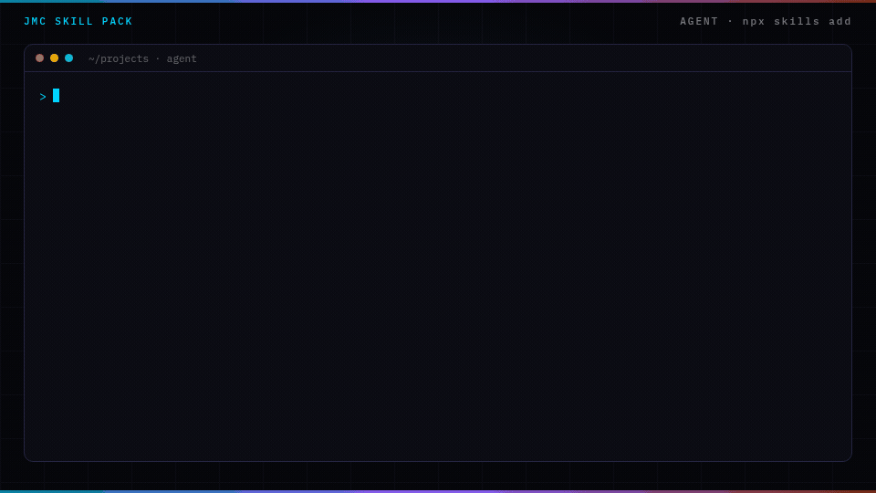

<p align="center">
  
</p>

<p align="center">
  
</p>

# GTM skills for Claude Code, Codex and Cursor

Eighteen MIT go-to-market skill packs for Claude Code, Codex, Cursor and any agent that reads `SKILL.md`. Each pack refuses the generic version of its job and scores its own draft with a Python script. The scorers use no LLM judge, no key and no network call.

The build guide teaches the framework to a human. The pack teaches the same framework to an agent.

## Install

Paste this into your agent:

```text
Install the GTM skills from https://github.com/cmj-hub/gtm-operator-skills
```

Or run it yourself:

```bash
npx skills add cmj-hub/gtm-operator-skills --all -g --full-depth
```

Claude Code, the whole suite and its two setup commands:

```text
/plugin marketplace add cmj-hub/gtm-operator-skills
/plugin install gtm@gtm-operator-skills
/gtm:setup
/gtm:next
```

`/gtm:setup` asks the shared questions once (who you are, who you sell to, your voice), so no pack asks them again. `/gtm:next` reads what you have so far and names the next command, for example `Next: /evp:evp - no value line yet`. Each pack saves its draft in a `gtm/` folder in your project, one file per pack.

Want every draft scored as you go? Add [the mod](#the-mod-scores-and-checks-across-the-suite): `/plugin install gtm-operator@gtm-operator-skills`.

## The packs

| Pack | What it is | 15-minute artifact |
|---|---|---|
| [psp](skills/psp) ([repo](https://github.com/cmj-hub/claude-psp)) | An ideal customer profile is who buys, drawn from a public signal and the words they use. | Score the sample 100 vs 37, then do yours |
| [evp](skills/evp) ([repo](https://github.com/cmj-hub/claude-evp)) | A value proposition is one line that says why this buyer should care. | Three lines for three readers |
| [cold-email](skills/cold-email) ([repo](https://github.com/cmj-hub/claude-cold-email)) | A cold email is a short note to someone who has not asked to hear from you, anchored to a public signal. | One T1, linted |
| [founder-brand](skills/founder-brand) ([repo](https://github.com/cmj-hub/claude-founder-brand)) | LinkedIn posts for founders are posts a buyer can tell came from the operator, written from a real receipt. | One Proof post from a real receipt |
| [pricing](skills/pricing) ([repo](https://github.com/cmj-hub/claude-pricing)) | A pricing strategy is how you choose what to charge, what the price is compared with, and where the discount leaks. | `decoy_validator` on the sample tiers |
| [landing-page](skills/landing-page) ([repo](https://github.com/cmj-hub/claude-landing-page)) | A landing page is one page, one offer, and one action. | Score the sample page. A sitemap fails. |
| [geo](skills/geo) ([repo](https://github.com/cmj-hub/claude-geo)) | Generative engine optimization is how a page gets quoted by an answer engine. | Score the sample page. A content calendar fails. |
| [sales-offer](skills/sales-offer) ([repo](https://github.com/cmj-hub/claude-sales-offer)) | A sales offer is what the buyer gets, what it costs, and why now. | Score the sample offer. A pitch of the paid product fails. |
| [prospect-list](skills/prospect-list) ([repo](https://github.com/cmj-hub/claude-prospect-list)) | Sales prospecting builds the B2B prospect list you are willing to write to. | Score the sample list. A title-only list fails. |
| [email-sequence](skills/email-sequence) ([repo](https://github.com/cmj-hub/claude-email-sequence)) | An email sequence is the series of emails after someone raises their hand. | Score the sample sequence. A generic drip fails. |
| [qualify-before-enrich](skills/qualify-before-enrich) ([repo](https://github.com/cmj-hub/claude-qualify-before-enrich)) | Qualify-before-enrich is the rule that every list row must pass an ICP field check before any paid finder runs. | Score the sample rows. A paid lookup on a failing row fails. |
| [found-vs-deliverable](skills/found-vs-deliverable) ([repo](https://github.com/cmj-hub/claude-found-vs-deliverable)) | A found email is not sendable until verify returns deliverable: catch-all, unknown, and invalid stay in their buckets. | Score the sample verify. A catch-all marked valid fails. |
| [signal-with-a-link](skills/signal-with-a-link) ([repo](https://github.com/cmj-hub/claude-signal-with-a-link)) | A buying signal is a dated, linkable event: something the prospect did publicly, on a day you can name, at a URL you can open. | Score the sample signal. An intent score without a URL and a date fails. |
| [waterfall-email](skills/waterfall-email) ([repo](https://github.com/cmj-hub/claude-waterfall-email)) | An email waterfall is a cheapest-first cascade that finds a work email, burning inputs you hold before any paid finder. | Score the sample cascade. A 4xx retry or found-before-verify fails. |
| [inbound-from-domain](skills/inbound-from-domain) ([repo](https://github.com/cmj-hub/claude-inbound-from-domain)) | Inbound-from-domain enrichment takes an inbound email, classifies the domain, and routes the lead in seconds. | Score the sample inbound. A CRM write-back fails. |
| [offer-stack](skills/offer-stack) ([repo](https://github.com/cmj-hub/claude-offer-stack)) | Package what the buyer gets and the pain each part removes, with the math shown. | Score the sample stack. |
| [proof-assets](skills/proof-assets) ([repo](https://github.com/cmj-hub/claude-proof-assets)) | Keep proof a buyer can check, from someone who agreed you could use it, dated. | Score the sample proof. |
| [gtm-guardrails](skills/gtm-guardrails) ([repo](https://github.com/cmj-hub/claude-gtm-guardrails)) | Guardrails for an agent that can reach your CRM: reads allowed, writes asked first, deletes denied. | Score the sample settings. An open CRM allow rule fails. |

Each pack is MIT. No paid APIs inside. Scorers are Python you can run without an LLM. Every pack carries a `SECURITY.md` that says what it runs, reads, writes, and reaches.


## Skills by outcome

Say what you would say to a person. The skill fires on the phrase.

**Find who to sell to**
- "Who actually buys from us?" "Build my ICP." `/psp:psp`
- "Is this a real signal?" "Can I cite this?" `/signal-with-a-link:signal-with-a-link`
- "Who should I call this week?" "My list is just job titles." `/prospect-list:who-to-contact`
- "Clean this list before I enrich it." "Credits are burning on bad-fit accounts." `/qualify-before-enrich:qualify-before-enrich`

**Say it so they care**
- "Write my value proposition." "What do we say in one line?" `/evp:evp`
- "What should I post this week?" "My posts sound like AI." `/founder-brand:founder-brand`
- "Write a case study." "Can I use this logo?" `/proof-assets:proof-assets`

**Keep an agent safe in your CRM**
- "Connect Claude to my CRM." "Are my permissions safe?" `/gtm-guardrails:gtm-guardrails`

**Reach them**
- "Write a cold email." "Nobody is replying to my emails." "Will this hit spam?" `/cold-email:cold-email`
- "A first email that does not pitch." `/sales-offer:cold-offer`
- "Find work emails for this list." `/waterfall-email:waterfall-email`
- "Can I send to this address?" "What do I do with catch-all emails?" `/found-vs-deliverable:found-vs-deliverable`

**Turn interest into a deal**
- "Write a landing page." "Page with one CTA." `/landing-page:page`
- "Package my offer." "What is the cost of inaction?" `/offer-stack:offer-stack`
- "How should I price this?" "We discount too much." `/pricing:pricing`
- "What do I send after the lead magnet?" "My drip feels generic." `/email-sequence:lifecycle-email`
- "Route this inbound lead." "Is this a real company?" `/inbound-from-domain:inbound-from-domain`

**Be quoted by answer engines**
- "Do we show up in ChatGPT?" "Get quoted by Perplexity." `/geo:geo`

## Install one pack at a time

Other agents use the [skills CLI](https://skills.sh), which writes into Claude Code, Cursor, Codex, Grok, Copilot, Windsurf, Cline, OpenCode, and the rest of its list:

```bash
npx skills add cmj-hub/claude-psp --all -g --full-depth
npx skills add cmj-hub/claude-evp --all -g --full-depth
npx skills add cmj-hub/claude-cold-email --all -g --full-depth
npx skills add cmj-hub/claude-founder-brand --all -g --full-depth
npx skills add cmj-hub/claude-pricing --all -g --full-depth
npx skills add cmj-hub/claude-landing-page --all -g --full-depth
npx skills add cmj-hub/claude-geo --all -g --full-depth
npx skills add cmj-hub/claude-sales-offer --all -g --full-depth
npx skills add cmj-hub/claude-prospect-list --all -g --full-depth
npx skills add cmj-hub/claude-email-sequence --all -g --full-depth
npx skills add cmj-hub/claude-qualify-before-enrich --all -g --full-depth
npx skills add cmj-hub/claude-found-vs-deliverable --all -g --full-depth
npx skills add cmj-hub/claude-signal-with-a-link --all -g --full-depth
npx skills add cmj-hub/claude-waterfall-email --all -g --full-depth
npx skills add cmj-hub/claude-inbound-from-domain --all -g --full-depth
npx skills add cmj-hub/claude-offer-stack --all -g --full-depth
npx skills add cmj-hub/claude-proof-assets --all -g --full-depth
npx skills add cmj-hub/claude-gtm-guardrails --all -g --full-depth
```

Claude Code, one pack at a time:

```text
/plugin marketplace add cmj-hub/gtm-operator-skills
/plugin install psp@gtm-operator-skills
/plugin install evp@gtm-operator-skills
/plugin install cold-email@gtm-operator-skills
/plugin install founder-brand@gtm-operator-skills
/plugin install pricing@gtm-operator-skills
/plugin install landing-page@gtm-operator-skills
/plugin install geo@gtm-operator-skills
/plugin install sales-offer@gtm-operator-skills
/plugin install prospect-list@gtm-operator-skills
/plugin install email-sequence@gtm-operator-skills
/plugin install qualify-before-enrich@gtm-operator-skills
/plugin install found-vs-deliverable@gtm-operator-skills
/plugin install signal-with-a-link@gtm-operator-skills
/plugin install waterfall-email@gtm-operator-skills
/plugin install inbound-from-domain@gtm-operator-skills
/plugin install offer-stack@gtm-operator-skills
/plugin install proof-assets@gtm-operator-skills
/plugin install gtm-guardrails@gtm-operator-skills
```

## How the packs work together

Each pack does one job and hands off to the next. Install the ones you need; a pack that needs a missing companion names it and its install line instead of doing its job inline.

| Step | Pack | Call it | Reads | Hands off to |
|---|---|---|---|---|
| 1 | psp | `/psp:psp` | `operator`, `icp` | evp, prospect-list, pricing |
| 2 | evp | `/evp:evp` | `psp` | cold-email, landing-page, sales-offer |
| 3 | prospect-list | `/prospect-list:who-to-contact` | `psp.signal_anchors`, `icp` | cold-email, sales-offer |
| 4 | cold-email | `/cold-email:cold-email` | `psp`, `evp`, `tone`, `infrastructure` | email-sequence |
| 5 | sales-offer | `/sales-offer:cold-offer` | `psp`, `evp` | landing-page, pricing |
| 6 | pricing | `/pricing:pricing` | `psp`, `icp` | landing-page, sales-offer |
| 7 | landing-page | `/landing-page:page` | `evp`, `pricing` | email-sequence, geo |
| 8 | email-sequence | `/email-sequence:lifecycle-email` | `psp.vocabulary`, `evp` | — |
| 9 | geo | `/geo:geo` | `psp.vocabulary` | landing-page |
| 10 | founder-brand | `/founder-brand:founder-brand` | `operator`, `audience`, `pillars` | — |
| 11 | qualify-before-enrich | `/qualify-before-enrich:qualify-before-enrich` | `icp`, list rows | prospect-list, waterfall-email |
| 12 | signal-with-a-link | `/signal-with-a-link:signal-with-a-link` | public event | psp, prospect-list, cold-email |
| 13 | waterfall-email | `/waterfall-email:waterfall-email` | held inputs, person | found-vs-deliverable, cold-email |
| 14 | found-vs-deliverable | `/found-vs-deliverable:found-vs-deliverable` | found address | cold-email |
| 15 | inbound-from-domain | `/inbound-from-domain:inbound-from-domain` | inbound email | — |
| 16 | offer-stack | `/offer-stack:offer-stack` | `psp`, `icp` | pricing, sales-offer |
| 17 | proof-assets | `/proof-assets:proof-assets` | `offer-stack` pains | landing-page, founder-brand, cold-email |
| 18 | gtm-guardrails | `/gtm-guardrails:gtm-guardrails` | CRM server name, settings file | none |

Where two packs sound alike, they split the job:

- **cold-email** writes a signal-anchored first touch and its follow-ups. **sales-offer** writes a give-first first touch that hands over a finding and does not pitch.
- **prospect-list** picks who to contact this week. **cold-email** cleans a send list you already have.
- **email-sequence** writes to people who opted in. **cold-email** nurtures prospects who have not.
- **qualify-before-enrich** holds paid finders until the row passes ICP. **waterfall-email** finds the address cheapest-first after that gate.
- **found-vs-deliverable** decides whether a found address is sendable. **waterfall-email** ends in that verify step.
- **signal-with-a-link** scores a dated public event. **psp** turns that signal into the buying brief.
- **offer-stack** packages what the buyer gets and the pain each part removes, with the math shown. **sales-offer** writes the give-first first email.
- **proof-assets** keeps proof a buyer can check, from someone who agreed you could use it, dated. **founder-brand** writes the post from one receipt.
- **gtm-guardrails** sets up and scores what an agent may do in your CRM: read, ask first, never delete. It does not write outreach or score leads.

### Shared files

Every pack reads one `brand-config.json` and one `SOUL.md` at your project root.

- **Merge, never overwrite.** A pack reads the file, changes only the fields it owns, and leaves every other key alone. It asks before changing a field that already has a value.
- **`operator` and `icp` are shared.** Any pack fills a gap. None replaces a value.
- **Two published blocks carry the handoff.** psp writes `psp` when a primary profile is locked: `signal_anchors`, `primary_pain`, `timing_trigger`, `felt_pain_role`, `vocabulary`. evp writes `evp` when you pick the outreach line: `tier`, `primary`, `outcome`, `tradeoff`, `proof`. Downstream packs read these and do not invent them.
- **SOUL.md is voice, sectioned by pack.** Each pack edits its own `##` section. Voice can change word choice. It cannot lift a pack's limits.
- **Drafts live in `gtm/`, one file per pack.** `gtm/list.json`, `gtm/letter.json`, `gtm/offer.json`, `gtm/price.json`, `gtm/page.json`, `gtm/sequence.json`, `gtm/findability.json`. Founder posts stay in `drafts/`. No two packs write the same file.

## The mod: scores and checks across the suite

The [GTM operator mod](https://github.com/cmj-hub/gtm-operator-claude-mod) is a Claude Code mod that runs each pack's own scorer on its draft and shows the results in Claude Code. It reads the same files `/gtm:next` reads, and adds:

- **Scores:** every step on the `/gtm-board` pane shows its draft's score (`37/100 · 9 fixes`, `pass`) and trend. Press a step for the fixes and **Fix with Claude**. A saved draft is scored at once, and an optional minimum score refuses a draft below it.
- **Cross-pack checks:** drafts gone stale after a PSP, EVP or price change; a landing page that doesn't lead with the EVP or name the price tiers; a letter or sequence with none of the buyer's words; roles the prospect list leaves out.
- **Views:** pricing waterfall and tier check, prospect board, cold email (lint, subject, replies, deliverability), EVP ladder, GEO, founder posting rotation.
- **Actions:** the band above the prompt names the next pack, with **Use** and **Run**. `/gtm-sprint` runs the packs in order, each only after the one before passes its scorer. Claude gets `gtm_status`, `gtm_score` and `gtm_consistency` tools and a read-only `reviewer` subagent.
- **Analytics:** drafts and time to pass, fixes resolved, replies and meetings you log against the live cold email, and a weekly digest.
- **The guard:** a write that would drop or change a filled `brand-config.json` value, or remove a `SOUL.md` section, is refused until you approve it (`/gtm-guard off`).

```text
/plugin install gtm-operator@gtm-operator-skills
```

## The company context pack

[company-context-pack](company-context-pack/README.md) is a short interview that writes `company.md`, `icp.md`, `offer.md`, `proof.md`, `voice.md`, `objections.md`, and `categories.md` into a `context/` folder, with an index any pack or agent reads first. It is not one of the eighteen: it feeds them. It lives in this repo for now.

```text
/plugin install company-context-pack@gtm-operator-skills
```

## Pick GTM tools with The GTM Directory

[pick-gtm-tools](pick-gtm-tools) teaches your agent to search, compare and shortlist GTM tools through [The GTM Directory](https://thegtmdirectory.com?utm_source=github&utm_medium=readme&utm_campaign=gtm-operator-skills)'s free, read-only MCP server. Every tool it names links its TGD page and a dated, vendor-verified fact. It will not name a tool TGD does not list, and it does not quote prices. In Claude Code the plugin connects the server for you:

```text
/plugin install pick-gtm-tools@gtm-operator-skills
/pick-gtm-tools:pick-gtm-tools cold email my agent can drive, inside Clay
```

Other agents: the install line and the server setup are in [pick-gtm-tools/README.md](pick-gtm-tools/README.md).

## The gate

The gate for the next pack is [build-pack/SKILL.md](build-pack/SKILL.md). Run it from that directory, or install it with `/plugin install build-pack@gtm-operator-skills`. It is for pack authors, not a customer pack.

## Audit your own setup

Too many skills and MCP servers installed? [skill-audit](skill-audit/README.md) reads your Claude Code setup and prints a short ranked report: context cost, overlapping descriptions, descriptions that are too long or vague, and skills with missing files. It is read-only. It does not delete or edit anything.

```text
/plugin install skill-audit@gtm-operator-skills
```

To check all eighteen packs together, clone them next to this repo and run:

```bash
python3 scripts/check_suite.py
```

It runs the gate, each pack's tests, `claude plugin validate --strict`, and a load check that every SKILL.md becomes a skill. It also fails a pack with no `SECURITY.md`, no icon, a `plugin.json` without `repository`, `license`, `documentationUrl`, or `supportUrl`, or a tracked `.pyc` or `__pycache__`.

## Privacy and security

The scorers and checkers are standard-library Python that run on your machine. No telemetry, no credentials, and no pack sends, posts, or publishes anything for you. Skills that reach the network do it through your agent, for public pages or DNS you point them at (psp, cold-email, and pricing can fetch public pages; cold-email runs `dig`; geo checks the URL you name), and each pack's `SECURITY.md` says which. The suite policy and the per-pack links are in [SECURITY.md](SECURITY.md).

## Free first

Every file in this repo is complete and MIT. Nothing here needs an account, a key, or a paid tool. If you want more, take the steps in order and stop wherever it is enough:

1. **[Hosted tools](https://jaymountconsulting.com/prototypes?utm_source=github&utm_medium=readme&utm_campaign=gtm-operator-skills)** - the same jobs these packs do, in a browser. No account, no key.
2. **[Growth Audit](https://jaymountconsulting.com/growth-audit?utm_source=github&utm_medium=readme&utm_campaign=gtm-operator-skills)** - where your go-to-market stack is leaking, sent to your inbox. It asks for an email and enrols you in a short follow-up on the same topic. Unsubscribe whenever.
3. **[The Friday Signal](https://jaymountconsulting.com/newsletter/signal?utm_source=github&utm_medium=readme&utm_campaign=gtm-operator-skills)** - free emails on building GTM systems. One click unsubscribes.

Pack pages with the written method behind each pack: [psp](https://jaymountconsulting.com/skills/claude-psp?utm_source=github&utm_medium=readme&utm_campaign=psp), [evp](https://jaymountconsulting.com/skills/claude-evp?utm_source=github&utm_medium=readme&utm_campaign=evp), [cold-email](https://jaymountconsulting.com/skills/claude-cold-email?utm_source=github&utm_medium=readme&utm_campaign=cold-email), [founder-brand](https://jaymountconsulting.com/skills/claude-founder-brand?utm_source=github&utm_medium=readme&utm_campaign=founder-brand), [pricing](https://jaymountconsulting.com/skills/claude-pricing?utm_source=github&utm_medium=readme&utm_campaign=pricing), [landing-page](https://jaymountconsulting.com/skills/claude-landing-page?utm_source=github&utm_medium=readme&utm_campaign=landing-page), [geo](https://jaymountconsulting.com/skills/claude-geo?utm_source=github&utm_medium=readme&utm_campaign=geo), [sales-offer](https://jaymountconsulting.com/skills/claude-sales-offer?utm_source=github&utm_medium=readme&utm_campaign=sales-offer), [prospect-list](https://jaymountconsulting.com/skills/claude-prospect-list?utm_source=github&utm_medium=readme&utm_campaign=prospect-list), [email-sequence](https://jaymountconsulting.com/skills/claude-email-sequence?utm_source=github&utm_medium=readme&utm_campaign=email-sequence). Also [Frameworks](https://jaymountconsulting.com/frameworks?utm_source=github&utm_medium=readme&utm_campaign=gtm-operator-skills), [Playbooks](https://jaymountconsulting.com/playbooks?utm_source=github&utm_medium=readme&utm_campaign=gtm-operator-skills), [Prompt Library](https://jaymountconsulting.com/resources/prompt-library?utm_source=github&utm_medium=readme&utm_campaign=gtm-operator-skills) and [Calculator Pack](https://jaymountconsulting.com/resources/calculator-pack?utm_source=github&utm_medium=readme&utm_campaign=gtm-operator-skills).

This suite drafts and scores. It will not pick this quarter's PSP, ingest your CRM, or update when Gmail changes the spam window. Those are judgement calls and live data: you bring the account.

## License

MIT on every pack. Built by [JMC Go-to-Market Systems](https://jaymountconsulting.com?utm_source=github&utm_medium=readme&utm_campaign=gtm-operator-skills).

## Regenerating the artwork

`assets/social-preview.png` and `assets/header.png` are generated from `assets/spec.json` by a vendored renderer. No CI, no shared workflow, no network beyond the webfonts:

```bash
node assets/card.mjs assets/spec.json assets/
```

`assets/demo.gif` uses the same `spec.json` plus `assets/demo.mjs` (playwright-core + ffmpeg):

```bash
cd assets && npm install playwright-core
CHROME=/usr/bin/google-chrome node demo.mjs spec.json demo.gif
```
