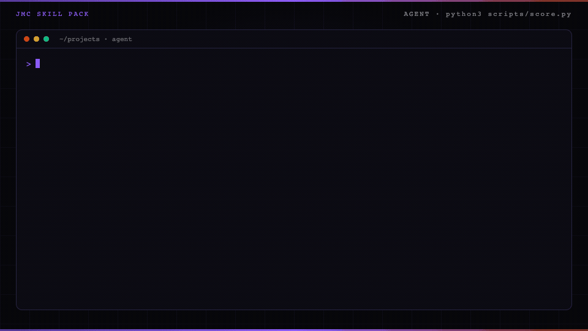

<p align="center">
  
</p>

# Email sequence skill for Claude Code

An email sequence is the series of emails after someone raises their hand.

## In 60 seconds

```text
/plugin marketplace add cmj-hub/gtm-operator-skills
/plugin install email-sequence@gtm-operator-skills
/email-sequence:lifecycle-email
```

Or score the sample without an agent:

```bash
python3 scripts/score.py --file examples/lifecycle-good.json      # exit 0, prints welcome, bargain, nurture, then "Next: /gtm:next"
python3 scripts/score.py --file examples/lifecycle-refused.json   # exit 1: - cold email: welcome says "introduce our" → they opted in; name what they asked for instead of introducing the product
```

Part of the GTM operator suite — `/plugin install gtm@gtm-operator-skills` installs all seventeen.

Add the [gtm-operator mod](https://github.com/cmj-hub/gtm-operator-claude-mod) to see the suite's next step above your prompt and keep `brand-config.json` from being overwritten: `/plugin install gtm-operator@gtm-operator-skills`.

The sample starts with the trial checklist they asked for.

The good draft passes. A generic drip fails the score.

<p align="center">
  
</p>

The build guide teaches a human. The pack teaches an agent.

## Install

In Claude Code, install it from the suite marketplace (the two lines above).

Other agents (Codex, Cursor, and the rest) can install it with the skills CLI:

```
npx skills add cmj-hub/claude-email-sequence --all -g --full-depth
```

Or clone the repository and open the tree on the host you already run.

The scorer is Python in this repo. Host paths are on the [Skill packs catalog](https://jaymountconsulting.com/skills).

In Claude Code the repo is a plugin named `email-sequence`. Its one skill is `lifecycle-email` (in `skills/lifecycle-email/`), so the command is `/email-sequence:lifecycle-email`; `/email-sequence:lifecycle-email score` scores the draft already in `gtm/sequence.json`. Moved in 0.7: the skill left the repo root for `skills/lifecycle-email/`, and the draft moved from `draft.json` to `gtm/sequence.json`. The command is unchanged. The agent also picks it up on its own when you ask for a welcome, onboarding, or nurture sequence.

## What you walk out with in 15 minutes

Artifact: `examples/lifecycle-good.json`.

```
python3 scripts/score.py --file examples/lifecycle-good.json
python3 scripts/score.py --file examples/lifecycle-refused.json
```

The good draft exits 0 and prints the welcome, the bargain, and the nurture. The refused draft exits 1 and names each gate it failed:

```
a generic drip and a cold email
- cold email: welcome says "introduce our" → they opted in; name what they asked for instead of introducing the product
- generic drip: bargain says "Day 1" → drop the day-1/day-3/day-7 or tip-series framing; write to their pain
- generic drip: nurture says "generic drip" → drop the day-1/day-3/day-7 or tip-series framing; write to their pain
- cold email: nurture says "cold email" → they opted in; name what they asked for instead of introducing the product
- pain mismatch: nurture does not repeat the pain in their words → repeat the pain phrase inside nurture, in their words
- no opt-in: welcome does not say they asked, opted in, or signed up → say in the welcome that they asked, opted in, or signed up
Next: fix the lines above and run this again.
```

Then drop in yours at `gtm/sequence.json`. Add `--json` when another tool reads the result (`fixes` and `next` ride along). `examples/lifecycle-subjects.json` adds the optional subject lines.

## What this pack will not do

It will not send the email. It does not write a generic drip. It will not write a cold email.

## The data step this pack leaves to you

This pack scores welcome, bargain, and nurture. Address verification before send sits outside the pack.

Run [Verify an email](https://thegtmdirectory.com/jobs/verify-an-email) on The Growth Desk before any sequence goes out. A found address is not sendable until verify returns deliverable.

## Does this include a newsletter?

One issue can sit inside the sequence. A newsletter product is not a separate pack.

## Does this send the sequence?

No. It scores the draft. Your email tool sends it.

## On the site

- [Email sequence pack](https://jaymountconsulting.com/skills/claude-email-sequence) — this pack's page
- [Skill packs catalog](https://jaymountconsulting.com/skills) — install paths + every pack

## Free, no signup

[All free tools](https://jaymountconsulting.com/prototypes)

## Free, by email

[**Growth Audit**](https://jaymountconsulting.com/growth-audit) — architecture gaps in the GTM you already run. Free written report.

[**Friday Signal**](https://jaymountconsulting.com/newsletter/signal) — one Friday GTM read. No pitch in it.

## Next

Previous: [Cold email](https://github.com/cmj-hub/claude-cold-email)

Next: [Sales prospecting](https://github.com/cmj-hub/claude-prospect-list)

## Privacy and security

The scorer is local Python 3 standard library. It reads the draft JSON you pass it and nothing else; the skill reads `brand-config.json` if present and writes no file outside your draft, `gtm/sequence.json`. No script opens a network connection. No telemetry, no credentials, and nothing is sent. See [SECURITY.md](SECURITY.md).

## License

MIT. No paid APIs. Python 3 standard library only.
