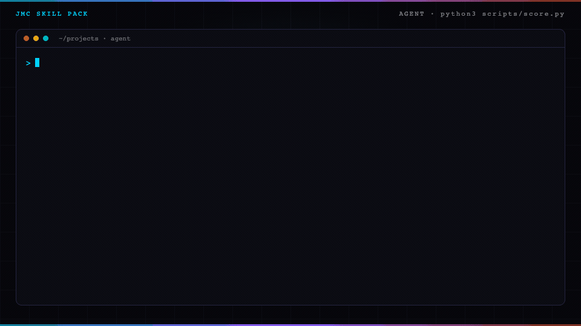

<p align="center">
  
</p>

# Found vs deliverable skill for Claude Code

A found-vs-deliverable gate is the rule that a found email is not sendable until verify returns deliverable: catch-all, unknown, and invalid stay in their buckets.

Replace a $15K list-ops cleanse with a scorer you run in fifteen minutes on one address.

## In 60 seconds

```text
/plugin marketplace add cmj-hub/gtm-operator-skills
/plugin install found-vs-deliverable@gtm-operator-skills
/found-vs-deliverable:found-vs-deliverable
```

Or score the sample without an agent:

```bash
python3 skills/found-vs-deliverable/scripts/score.py --file skills/found-vs-deliverable/examples/verify-good.json       # exit 0, deliverable
python3 skills/found-vs-deliverable/scripts/score.py --file skills/found-vs-deliverable/examples/verify-catchall.json   # exit 1: never send catch-all as valid
```

Part of the GTM operator suite: `/plugin install gtm@gtm-operator-skills` installs the catalog.

Add the [gtm-operator mod](https://github.com/cmj-hub/gtm-operator-claude-mod) to see the suite's next step above your prompt: `/plugin install gtm-operator@gtm-operator-skills`.

`alex@northwind.io` verified deliverable → sendable. `ops@fabrikam.com` catch-all marked sendable → refused.

<p align="center">
  
</p>

The build guide teaches a human. The pack teaches an agent.

## Install

As a Claude Code plugin:

```text
/plugin marketplace add cmj-hub/claude-found-vs-deliverable
/plugin install found-vs-deliverable@claude-found-vs-deliverable
```

The skill then loads as `/found-vs-deliverable:found-vs-deliverable`. Ask whether an address is sendable, or hand it a verify row. `/found-vs-deliverable:found-vs-deliverable score` scores the draft already in `gtm/verify.json`.

For every agent host the skills installer knows:

```bash
npx skills add cmj-hub/claude-found-vs-deliverable --all -g --full-depth
```

One host:

```bash
npx skills add cmj-hub/claude-found-vs-deliverable --skill '*' -g --full-depth -y -a claude-code
```

Swap `claude-code` for `cursor`, `codex`, `grok`, `github-copilot`, `windsurf`, `cline`, or `opencode`. The scorer is Python in this repo. It does not call a paid API, and it does not buy data.

## What you walk out with in 15 minutes

```bash
cd skills/found-vs-deliverable
python3 scripts/score.py --file examples/verify-good.json
python3 scripts/score.py --file examples/verify-catchall.json
```

The good draft exits 0 and prints a deliverable verify. The catch-all draft exits 1 and prints one `- what is wrong → what to change` line, then `Next: fix the lines above and run this again.` Found marked sendable, unknown marked sendable, and invalid marked sendable fail the same way. Add `--json` for one result object (`fixes` and `next` included). Then drop in yours at `gtm/verify.json` in your project.

## What's in the pack

| Path | What it is |
| --- | --- |
| `skills/found-vs-deliverable/SKILL.md` | The skill: find then verify, the four buckets, the banned list. |
| `skills/found-vs-deliverable/scripts/score.py` | The scorer. Exit 0 scored, 1 refused, 2 unreadable input. |
| `skills/found-vs-deliverable/examples/` | Good, held catch-all, catch-all-as-valid, found-as-sendable, unknown, invalid. |
| `skills/found-vs-deliverable-kickoff/SKILL.md` | Router: sample → draft → score → next pack. |
| `.claude-plugin/` | Plugin and marketplace manifests for Claude Code, and the plugin icon. |
| `tests/` | `python3 -m unittest discover -s tests` |

## What this pack will not do

It will not call a paid email verifier. It will not send mail. It will not promote catch-all, unknown, or invalid to deliverable. It will not treat a found row as sendable.

## What is found vs deliverable?

Find then verify. Every address lands in one bucket: deliverable, catch-all, unknown, or invalid. Catch-all, unknown, and invalid are never "valid." Found is not sendable until verify = deliverable.

## Does this verify emails for me?

No. You bring the verify result (any tool you already use). The pack scores the gate: only `verified` + `deliverable` + `sendable: true` may go to send.

## Can I send catch-all if my bounce rate is low?

No. Catch-all means the domain accepts any local-part; the mailbox may not exist. This pack refuses catch-all marked sendable every time.

## Do I need Operator Pass to use this?

No, and there is no key to enter. The pack, the scorer, and the sample are MIT in this repo.

## On the site

- [Found vs deliverable pack](https://jaymountconsulting.com/skills/claude-found-vs-deliverable): this pack's page
- [Skill packs catalog](https://jaymountconsulting.com/skills): install paths + every pack
- [Cold Email & Outreach Craft](https://jaymountconsulting.com/learn/courses/cold-email-outreach-craft): the build guide for humans

## Free, no signup

[All free tools](https://jaymountconsulting.com/prototypes)

## Free, by email

[**Growth Audit**](https://jaymountconsulting.com/growth-audit): architecture gaps in the GTM you already run. Free written report.

[**Friday Signal**](https://jaymountconsulting.com/newsletter/signal): one Friday GTM read. No pitch in it.

## Part of the suite

Part of the GTM operator suite: see [gtm-operator-skills](https://github.com/cmj-hub/gtm-operator-skills).

## Companion packs

- [claude-prospect-list](https://github.com/cmj-hub/claude-prospect-list): who to contact from a buying signal
- [claude-qualify-before-enrich](https://github.com/cmj-hub/claude-qualify-before-enrich): ICP check before any finder
- [claude-cold-email](https://github.com/cmj-hub/claude-cold-email): signal-anchored first touch after a deliverable row
- [gtm-operator-skills](https://github.com/cmj-hub/gtm-operator-skills): suite install

## Privacy and security

The scorer is standard-library Python and opens no network connection. It reads only the draft you give it; the skill writes `gtm/verify.json` and never writes `brand-config.json`. No telemetry, no credentials, no lookups, and nothing is sent. See [SECURITY.md](SECURITY.md).

## Next

Previous: [Sales prospecting](https://github.com/cmj-hub/claude-prospect-list)

Next: [Cold email](https://github.com/cmj-hub/claude-cold-email) · [GTM skills for Claude Code](https://github.com/cmj-hub/gtm-operator-skills)

## License

MIT. See [LICENSE](LICENSE).

## About

Built by [JMC Go-to-Market Systems](https://jaymountconsulting.com).
