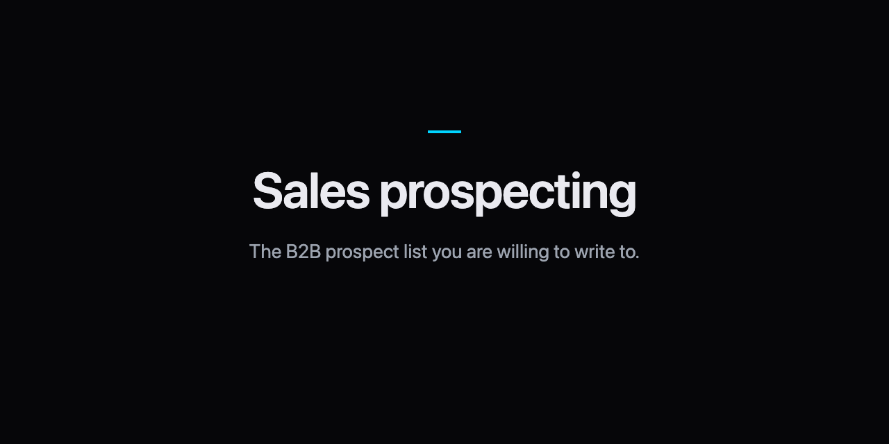

<p align="center">
  
</p>

# Qualify-before-enrich skill for Claude Code

Stop burning enrichment credits on rows that already fail your ICP. This pack gates every list row on industry, size, title, and geo **before** any paid finder runs.

## What is qualify-before-enrich?

Qualify-before-enrich is the rule that every list row must pass an ICP field check before any paid finder or enrichment credit is spent. A missing industry, wrong company size, or banned title fails the row. Failed rows stay dark. Credits go only to rows that already match.

## Scored before / after

| Draft | Exit | Result |
| --- | --- | --- |
| `examples/rows-good.json` | 0 | Northwind Logistics → **enrich** (ICP pass) |
| `examples/rows-fail-icp.json` | 1 | Fabrikam Retail → **paid lookup on a failing row** (wrong industry + credits already marked) |

```bash
python3 skills/qualify-before-enrich/scripts/score.py --file skills/qualify-before-enrich/examples/rows-good.json
# qualify pass: ICP before finder
# enrich: 1  hold: 0  drop: 0
# - Northwind Logistics: enrich
# Next: /prospect-list:who-to-contact

python3 skills/qualify-before-enrich/scripts/score.py --file skills/qualify-before-enrich/examples/rows-fail-icp.json
# paid lookup on a failing row
# - Fabrikam Retail: claimed 'enrich' but row fails ICP ... → set verdict to drop ...
# - Fabrikam Retail: paid lookup on a failing row → clear paid_lookup/...
# Next: fix the lines above and run this again.
```

The build guide teaches a human. The pack teaches an agent.

## Install

As a Claude Code plugin:

```text
/plugin marketplace add cmj-hub/claude-qualify-before-enrich
/plugin install qualify-before-enrich@claude-qualify-before-enrich
```

The skill loads as `/qualify-before-enrich:qualify-before-enrich`. Hand it a list, or run `/qualify-before-enrich:qualify-before-enrich score` on `gtm/qualify.json`.

For every agent host the skills installer knows:

```bash
npx skills add cmj-hub/claude-qualify-before-enrich --all -g --full-depth
```

One host:

```bash
npx skills add cmj-hub/claude-qualify-before-enrich --skill '*' -g --full-depth -y -a claude-code
```

Swap `claude-code` for `cursor`, `codex`, `grok`, `github-copilot`, `windsurf`, `cline`, or `opencode`. The scorer is Python in this repo. It does not call a paid API, and it does not buy data.

Part of the GTM operator suite: see [gtm-operator-skills](https://github.com/cmj-hub/gtm-operator-skills).

## What you walk out with in 15 minutes

Artifact: `gtm/qualify.json` (start from `skills/qualify-before-enrich/examples/rows-good.json`).

```bash
cd skills/qualify-before-enrich
python3 scripts/score.py --file examples/rows-good.json
python3 scripts/score.py --file examples/rows-fail-icp.json
python3 scripts/score.py --file examples/rows-missing-fields.json
```

The good draft exits 0 and prints which rows may take a finder. The fail-icp draft exits 1 because a paid lookup flag sits on a row outside the industry gate. The missing-fields draft exits 1 until industry is filled and verdict is `hold` or the row is complete. Then drop in yours at `gtm/qualify.json`.

## What's in the pack

| Path | What it is |
| --- | --- |
| `skills/qualify-before-enrich/SKILL.md` | The skill: ICP gate, banned list, checklist, worked example. |
| `skills/qualify-before-enrich/scripts/score.py` | The scorer. Exit 0 scored, 1 refused, 2 unreadable. |
| `skills/qualify-before-enrich/examples/` | Good, drop, fail-icp, and missing-fields drafts. |
| `.claude-plugin/` | Plugin and marketplace manifests for Claude Code. |
| `tests/` | `python3 -m unittest discover -s tests` |

## What this pack will not do

It will not run Apollo, ZoomInfo, Hunter, Clay, or any paid finder. It will not invent missing ICP fields. It will not send email or write back to your CRM.

This pack drafts and scores. It will not pick this quarter's PSP, ingest your CRM, or update when a vendor changes credit pricing.

## How is this different from a prospect list?

Prospect-list scores who earns a slot from a **buying signal**. This pack decides whether a row may spend an enrichment credit at all. Run qualify first; then signal-score the rows that pass.

## Do I need live enrichment APIs to start?

No. The scorer is standard-library Python on sample JSON. Zero paid APIs inside the pack.

## What happens to a failing row?

`hold` if a field is missing. `drop` if the fields are present and outside ICP. In both cases the ban is the same: **no paid lookup on a failing row.**

## Can I mark a row enrich and run the finder anyway?

The scorer refuses it. If `paid_lookup` / `finder_ran` / `enriched` is set on a non-enrich row, exit 1 names the ban in plain language.

## Part of the suite

Part of the GTM operator suite: see [gtm-operator-skills](https://github.com/cmj-hub/gtm-operator-skills).

## Companion packs + marketplace

- [claude-prospect-list](https://github.com/cmj-hub/claude-prospect-list): signal → call / hold / drop
- [claude-psp](https://github.com/cmj-hub/claude-psp). Pain Signal Profile that feeds the ICP
- [claude-cold-email](https://github.com/cmj-hub/claude-cold-email): first touch after the list is clean
- [gtm-operator-skills](https://github.com/cmj-hub/gtm-operator-skills): suite install for all packs

```text
/plugin marketplace add cmj-hub/gtm-operator-skills
```

## Privacy and security

The scorer is standard-library Python and opens no network connection. It reads only the draft you give it; the skill writes `gtm/qualify.json`, reads `brand-config.json` and never writes to it. No telemetry, no credentials, no lookups, and nothing is sent. See [SECURITY.md](SECURITY.md).

## License

MIT. Python 3 standard library only. See [LICENSE](./LICENSE).

## About

Built by [JMC Go-to-Market Systems](https://jaymountconsulting.com).
