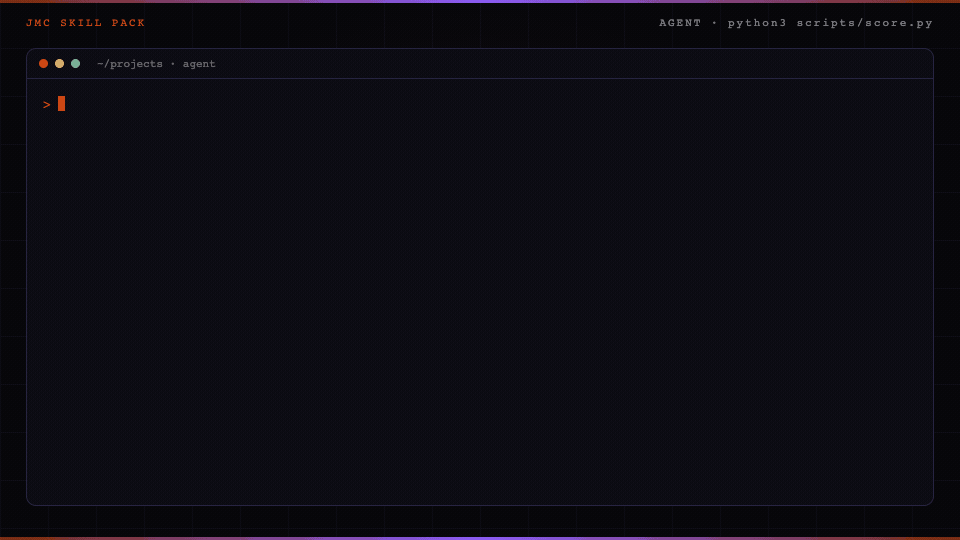

<p align="center">
  
</p>

# Sales offer skill for Claude Code

A sales offer is what the buyer gets, what it costs, and why now.

## In 60 seconds

```text
/plugin marketplace add cmj-hub/gtm-operator-skills
/plugin install sales-offer@gtm-operator-skills
/sales-offer:cold-offer
```

Or score the sample without an agent:

```bash
python3 skills/cold-offer/scripts/score.py --file skills/cold-offer/examples/offer-good.json    # exit 0, prints leak, prototype, email one, then "Next: /landing-page:page"
python3 skills/cold-offer/scripts/score.py --file skills/cold-offer/examples/offer-sells.json   # exit 1: - email one that sells the paid product (buy the, retainer, book a demo, our pricing) → Cut the ask to buy. Offer the full report only if they want it.
```

Part of the GTM operator suite — `/plugin install gtm@gtm-operator-skills` installs all seventeen.

Add the [gtm-operator mod](https://github.com/cmj-hub/gtm-operator-claude-mod) to see the suite's next step above your prompt and keep `brand-config.json` from being overwritten: `/plugin install gtm-operator@gtm-operator-skills`.

The sample homepage asks for a meeting before it shows any work.

The good first email hands over that finding. The draft that says "buy the retainer" fails the score.

<p align="center">
  
</p>

The build guide teaches a human. The pack teaches an agent.

The scorer is Python in this repo. It does not call a paid API. Host paths are on the [Skill packs catalog](https://jaymountconsulting.com/skills).

## Install

Claude Code: the two lines above. The command is `/sales-offer:cold-offer`; `/sales-offer:cold-offer score` scores the draft already in `gtm/offer.json`.

Other agents:

```text
npx skills add cmj-hub/claude-sales-offer --all -g --full-depth
```

## What you walk out with in 15 minutes

Artifact: `skills/cold-offer/examples/offer-good.json`.

```bash
cd skills/cold-offer
python3 scripts/score.py --file examples/offer-good.json
python3 scripts/score.py --file examples/offer-sells.json
```

The good draft exits 0 and prints the leak, the prototype, email one, and the next step. The sell draft exits 1 and prints one `- what is wrong (phrase) → what to change` line per failure. Then drop in yours at `gtm/offer.json` in your project. Add `--json` for one result object (`pass`, `failures` with a `fix` each, `next`).

## What this pack will not do

It will not send the email. It does not book a meeting. It will not let email one sell the paid product.

## The data step this pack leaves to you

This pack scores the leak, the prototype, and email one. Person-level enrichment for the recipient sits outside the pack.

Run [Enrich a person](https://thegtmdirectory.com/jobs/enrich-a-person) on The Growth Desk when you need a verified work identity before you send. A found address is not sendable until verify returns deliverable.

## Does this send the offer?

No. It scores the draft. You send it from your own sequencer.

## What fails the score?

Email one that sells the paid product. The first email delivers the finding. The paid product stays behind a yes.

The scorer also fails email one that asks for a meeting, that never states the finding, or that runs past 120 words. A leak or prototype that sells the paid product fails too. Optional `scope` must name one deliverable, and optional `deadline` must be a real `YYYY-MM-DD` date (not before `--today`, when given). Each failure names the phrase that tripped it and the fix.

## Layout

```
.claude-plugin/plugin.json      plugin manifest
skills/cold-offer/SKILL.md      the skill the agent loads
skills/cold-offer/scripts/      score.py
skills/cold-offer/examples/     good, sell, and scoped drafts
tests/                          python3 -m unittest discover -s tests
```

## On the site

- [Sales offer pack](https://jaymountconsulting.com/skills/claude-sales-offer) — this pack's page
- [Skill packs catalog](https://jaymountconsulting.com/skills) — install paths + every pack

## Free, no signup

[All free tools](https://jaymountconsulting.com/prototypes)

## Free, by email

[**Growth Audit**](https://jaymountconsulting.com/growth-audit) — architecture gaps in the GTM you already run. Free written report.

[**Friday Signal**](https://jaymountconsulting.com/newsletter/signal) — one Friday GTM read. No pitch in it.

## Next

Previous: [Pricing strategy](https://github.com/cmj-hub/claude-pricing)

Next: [Landing page](https://github.com/cmj-hub/claude-landing-page)

## Privacy and security

The scorer is local Python 3 standard library and reads only the draft JSON you pass it. No script opens a network connection. The skill reads `brand-config.json` if present and writes only the draft, `gtm/offer.json`; the agent reads the buyer's public page only when you give it a URL. No telemetry, no credentials, and nothing is sent. See [SECURITY.md](SECURITY.md).

## License

MIT. No paid APIs. Python 3 standard library only.
